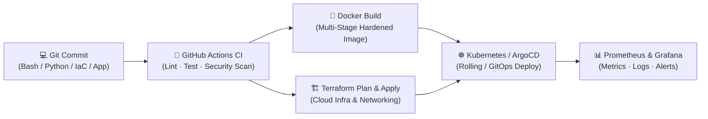

<div align="center">


<br/>

[](mailto:jcs@jcscode.com)


</div>

<br/>

---

### `js@infra:~$ whoami`

**Linux Systems & DevOps Engineer** focused on building **automated, reproducible, and security-hardened infrastructure** across Linux environments, containers, and cloud platforms.

My daily engineering revolves around **Linux administration**, **Bash & Python automation**, **Docker & Kubernetes orchestration**, **Terraform (IaC)**, and **CI/CD pipelines**. I approach infrastructure as software: every server configuration, deployment pipeline, and cloud resource should be version-controlled, idempotent, observable, and recoverable from code — eliminating manual toil and configuration drift.

```yaml
engineer:
  name: "Junio Silvestre"
  role: "Linux Systems & DevOps / Cloud Infrastructure Engineer"
  contact: "jcs@jcscode.com"
  core_stack:
    os_and_shell:   ["Linux (Ubuntu/Debian, RHEL/Rocky, Alpine)", "Bash", "Systemd", "SSH", "Networking"]
    containers:     ["Docker", "Kubernetes (K8s)", "Helm", "Container Security"]
    iac_and_config: ["Terraform", "HCL", "Automated Provisioning", "Linux Hardening"]
    cicd_gitops:    ["GitHub Actions", "ArgoCD", "GitOps", "Automated Pipelines"]
    scripting:      ["Python (Automation, CLI, SDKs/Boto3)", "POSIX Shell / Bash"]
    cloud_and_obs:  ["AWS", "Azure", "Prometheus", "Grafana", "OpenTelemetry"]
  principles:
    - "Automate repetitive operations with defensive Bash & Python scripts"
    - "Provision immutable, idempotent infrastructure via Terraform & Containers"
    - "Shift security and reliability left inside every CI/CD pipeline"
```

> *"If you have to do it twice, script it. If it runs in production, codify, test, and monitor it."*

<br/>

---

### 🧩 Core Engineering Competencies

<div align="center">

| 🐧 Linux & OS | 🐚 Bash & Python | 🐳 Docker & K8s | 🏗️ Terraform (IaC) | 🔁 CI/CD & GitOps | 📊 Observability |
|:---:|:---:|:---:|:---:|:---:|:---:|
| Systemd · Kernel · Networking · Hardening | Automation · CLI Tools · Cloud SDKs | Multi-stage builds · RBAC · Helm | Modular IaC · Remote State · Cloud | GitHub Actions · ArgoCD · Pipelines | Prometheus · Grafana · Logs |

</div>

<br/>

| Domain | What I Deliver in Production |
|---|---|
| 🐧 **Linux Systems Engineering** | Server provisioning, `systemd` unit/timer management, storage/LVM, process & resource tuning, SSH/firewall hardening (`ufw`/`nftables`/`iptables`), TCP/IP & DNS troubleshooting |
| 🐚 **Bash & Python Scripting** | Defensive Bash scripts (`set -euo pipefail`, trap handlers, automated backups/healthchecks) and Python automation tools (REST APIs, `boto3`, log parsers, operational CLIs) |
| 🐳 **Containers & Kubernetes** | Hardened multi-stage Dockerfiles (non-root, minimal attack surface), Docker Compose environments, Kubernetes deployments, RBAC, NetworkPolicies, Ingress, and Helm packaging |
| 🏗️ **Infrastructure as Code (Terraform)** | Reusable Terraform modules, remote state & locking, environment parity (`dev`/`staging`/`prod`), automated cloud networking (VPC, subnets, IAM, compute, managed K8s) |
| 🔁 **CI/CD & Release Automation** | End-to-end GitHub Actions workflows — linting (`shellcheck`, `tflint`), image vulnerability scanning, automated testing, container registry publishing, and zero-downtime GitOps rollouts |
| 📊 **Observability & Incident Readiness** | Prometheus metrics collection, Grafana alerting dashboards, centralized logging, health probes, and automated self-healing / diagnostic runbooks |

<br/>

---

### 🔄 Infrastructure & Delivery Workflow



<br/>

---

### 🛠️ Tech Stack & Tooling

**🐧 Operating Systems, Shell & Networking**


**🐳 Containers & Orchestration**


**🏗️ Infrastructure as Code & Cloud**


**🔁 CI/CD, GitOps & Automation**


**📊 Observability, Databases & Security**


<br/>

---

### 🏆 Certifications & Continuous Learning

<div align="center">

[-FCC624?style=for-the-badge&logo=linux&logoColor=black)](https://www.lpi.org/our-certifications/linux-essentials-overview)

</div>

<br/>

---

### 📌 Current Engineering Focus

| Area | Active Work |
|---|---|
| 🐧 **Linux & Bash** | Automating server bootstrapping, security hardening, health diagnostics, and maintenance tasks via idempotent POSIX/Bash scripts |
| 🐍 **Python for DevOps** | Writing infrastructure CLI tools, automated cloud resource auditors, and operational scripts |
| 🏗️ **Terraform (IaC)** | Building modular, reusable Terraform configurations for cloud networking, compute, and container clusters |
| 🐳 **Docker & Kubernetes** | Designing production-ready container images, Helm charts, and resilient Kubernetes deployments with RBAC and network isolation |
| 🔁 **CI/CD Pipelines** | Implementing automated validation, security scanning, and deployment pipelines with GitHub Actions |

<br/>

---

### 📊 GitHub Activity

<div align="center">


</div>

<br/>

---

### 💼 Open to Opportunities

<div align="center">

I am open to **Linux Systems Engineer · DevOps Engineer · Cloud / Infrastructure Engineer · SRE** opportunities where automation, Infrastructure as Code, container orchestration, and Linux reliability are core to the engineering culture.

[](mailto:jcs@jcscode.com)

</div>

<br/>

<div align="center">


</div>
