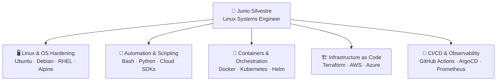
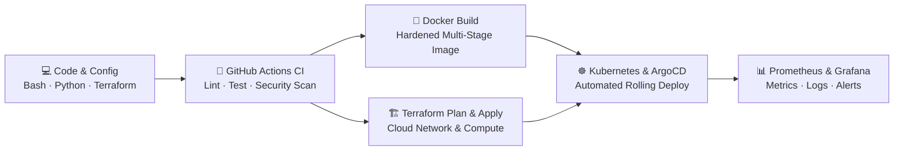
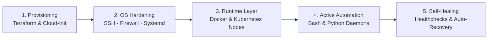
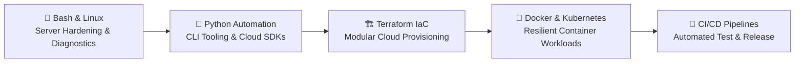

 

  
  
  
  

 

---

### 🎯 About Me

**Linux Systems Engineer** focused on building **automated, reproducible, and security-hardened infrastructure** across Linux environments, containers, and cloud platforms.

My daily engineering revolves around **Linux administration**, **Bash & Python automation**, **Docker & Kubernetes orchestration**, **Terraform (IaC)**, and **CI/CD pipelines**. Every server configuration, deployment workflow, and cloud resource I deliver is version-controlled, idempotent, observable, and recoverable — eliminating manual intervention and configuration drift.

- 📫 **Direct Contact:** [jcs@jcscode.com](mailto:jcs@jcscode.com)
- 🐧 **Core Focus:** Linux Systems Engineering, Container Orchestration, Cloud Infrastructure & Automation

> *"If you have to do it twice, automate it. If it runs in production, codify, test, and monitor it."*

 

---

### 🧩 Core Engineering Competencies

| Domain | What I Deliver in Production |
|---|---|
| 🐧 **Linux Systems Engineering** | Server provisioning, systemd service and timer management, storage and LVM, kernel and resource tuning, SSH and firewall hardening, TCP/IP and DNS troubleshooting |
| 🐚 **Bash & Python Automation** | Defensive Bash scripts for automated backups, provisioning, and healthchecks; Python CLI tools, REST API integrations, log analyzers, and cloud automation |
| 🐳 **Docker & Kubernetes** | Hardened multi-stage Docker images, Docker Compose environments, Kubernetes cluster workloads, RBAC, NetworkPolicies, Ingress, and Helm charts |
| 🏗️ **Terraform (IaC)** | Reusable Terraform modules, remote state and locking, multi-environment isolation, and automated cloud networking and compute provisioning |
| 🔁 **CI/CD & GitOps** | Automated GitHub Actions pipelines for script validation, container vulnerability scanning, automated builds, and zero-downtime GitOps deployments with ArgoCD |
| 📊 **Observability & Reliability** | Prometheus metrics, Grafana dashboards, OpenTelemetry instrumentation, centralized logging, and automated diagnostic runbooks |

 

---

### 🔄 CI/CD & Infrastructure Delivery Workflow

 

---

### 🛡️ Linux Lifecycle & Automation Workflow

 

---

### 🛠️ Tech Stack & Tooling

**🐧 Operating Systems, Shell & Networking**

  
  
  
  
  
  
  
  

**🐳 Containers & Orchestration**

  
  
  

**🏗️ Infrastructure as Code & Cloud**

  
  
  

**🔁 CI/CD, GitOps & Automation**

  
  
  
  

**📊 Observability & Data Services**

  
  
  
  
  

 

---

### 🏆 Certifications & Continuous Learning

  

 

---

### 📌 Current Engineering Focus

 

---

### 📊 GitHub Activity

 

---

### 💼 Open to Opportunities

  I am open to <strong>Linux Systems Engineer · Infrastructure Engineer · DevOps / SRE</strong> opportunities where Linux reliability, automation, Infrastructure as Code, and container orchestration are core to the engineering culture.

  

 

