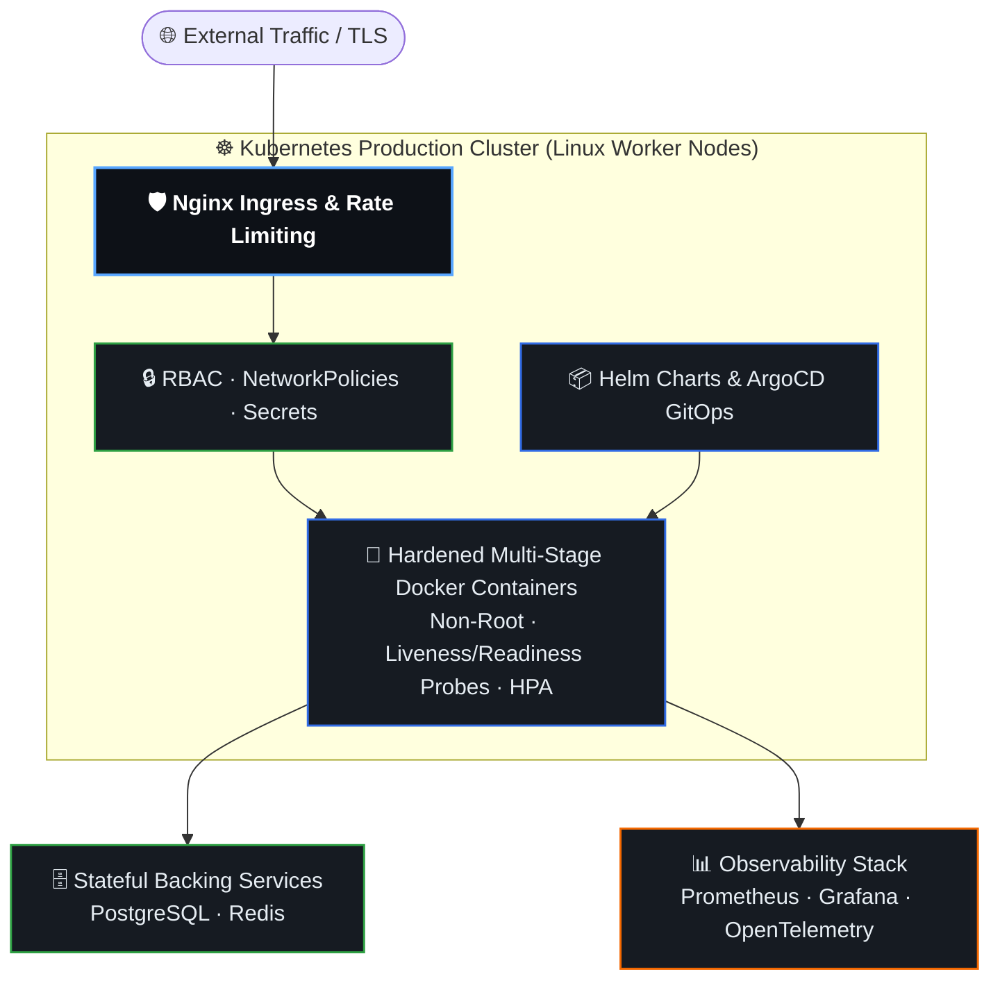
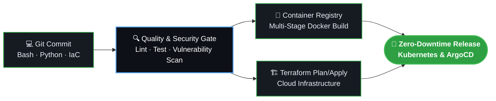

  
  
  
  

---

### 🎯 About Me

**Linux Systems Engineer** focused on designing, automating, and operating **reliable, security-hardened Linux and cloud-native environments**.

I combine deep hands-on **Linux systems administration** with modern DevOps engineering: automating repetitive operations with **Bash and Python**, containerizing and orchestrating workloads with **Docker and Kubernetes**, provisioning reproducible cloud infrastructure with **Terraform**, and enforcing quality through **CI/CD pipelines**.

> [!IMPORTANT]
> **Engineering Philosophy:** *"If an operation has to be done twice, script it. If it runs in production, codify it in Terraform, isolate it in containers, validate it in CI/CD, and monitor it continuously."*
>
> 📫 **Direct Contact:** [jcs@jcscode.com](mailto:jcs@jcscode.com)

 

---

### 🛠️ Tech Ecosystem Overview

<table>
  <tr>
    <td align="center" width="33%">
      <h4>🐧 Linux, Scripting & Networking</h4>
      
        
      <b>Ubuntu · Debian · RHEL/Rocky · Alpine GNU Bash · Python · Nginx · Tailscale</b>
    </td>
    <td align="center" width="33%">
      <h4>🐳 Containers, K8s & Cloud IaC</h4>
      
        
      <b>Docker · Kubernetes · Helm Terraform (IaC) · AWS · Azure</b>
    </td>
    <td align="center" width="33%">
      <h4>🔁 CI/CD, GitOps & Observability</h4>
      
        
      <b>GitHub Actions · ArgoCD · Git Prometheus · Grafana · OpenTelemetry</b>
    </td>
  </tr>
</table>

 

---

### 🐧 1. Linux Systems & Bash / Python Automation

<table>
  <tr>
    <td width="50%" valign="top">
      <h4>🛡️ Linux Administration & Hardening</h4>
      <ul>
        <li><b>OS & Services:</b> Provisioning and managing Ubuntu, Debian, RHEL/Rocky, and Alpine servers; systemd units, timers, and journald diagnostics.</li>
        <li><b>Storage & Performance:</b> Filesystem management, LVM volume provisioning, memory/process inspection, and sysctl kernel tuning.</li>
        <li><b>Network & Security:</b> SSH hardening, least-privilege access/sudo policies, firewall rules (UFW / nftables / iptables), TCP/IP & DNS troubleshooting, Nginx reverse proxy, and Tailscale mesh networking.</li>
      </ul>
    </td>
    <td width="50%" valign="top">
      <h4>🐚 Bash & Python Operational Tooling</h4>
      <ul>
        <li><b>Defensive Bash Scripting:</b> Idempotent scripts for server bootstrapping, automated backups, log rotation, certificate renewal, and service auto-recovery.</li>
        <li><b>Python Automation:</b> Custom CLI utilities, REST API integrations, Cloud SDK (Boto3) resource automation, and structured log/metric parsers.</li>
        <li><b>Zero Drift:</b> Replacing manual SSH maintenance ("snowflake servers") with version-controlled, repeatable scripts and scheduled automation.</li>
      </ul>
    </td>
  </tr>
</table>

 

---

### 🐳 2. Docker & Kubernetes Cluster Architecture

Rather than running monolithic workloads directly on host OS packages, I package services into **hardened, minimal Docker images** and orchestrate them on **Kubernetes** with strict isolation, self-healing probes, and observability:

 

---

### 🏗️ 3. Terraform (IaC) & Cloud Infrastructure

| Pillar | Implementation Approach | Key Focus |
|---|---|---|
| **🧱 Modular Terraform** | Reusable, parameterized Terraform modules for networking (VPC, subnets, routing), compute, IAM, and managed container clusters | Reusability & clean code |
| **🔒 Remote State & Locking** | Centralized remote state storage with state locking and strict separation between **dev**, **staging**, and **production** environments | Team safety & zero state corruption |
| **☁️ Cloud & Hybrid Ready** | Automated provisioning across **AWS** and **Azure**, combined with Linux cloud-init bootstrapping for immediate node readiness | Fast, repeatable recovery |
| **🛡️ Policy & Validation** | Automated formatting, syntax validation, and security checks before any infrastructure plan is applied | Shift-left infrastructure security |

 

---

### 🔁 4. CI/CD & Automated Delivery Pipeline

Every change — whether a **Bash script**, **Python tool**, **Terraform module**, or **Dockerized service** — passes through an automated **CI/CD pipeline**:

 

---

### 🏆 Certifications & Continuous Learning

 

---

### 📊 GitHub Activity & Metrics

 

---

### 💼 Open to Opportunities

  I am open to <strong>Linux Systems Engineer · Infrastructure Engineer · DevOps / SRE</strong> roles where Linux reliability, Bash/Python automation, Terraform (IaC), and Kubernetes orchestration are core to the engineering culture.

  

